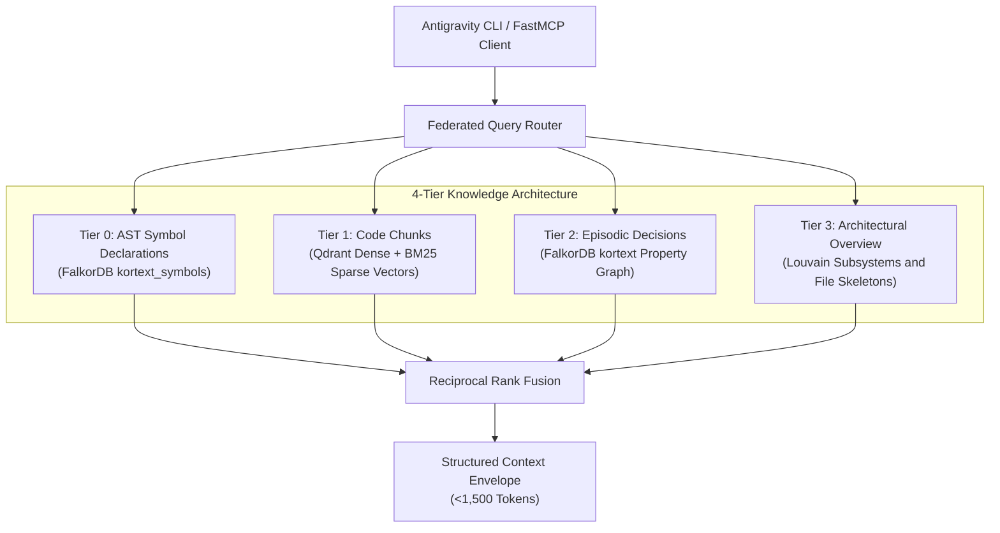
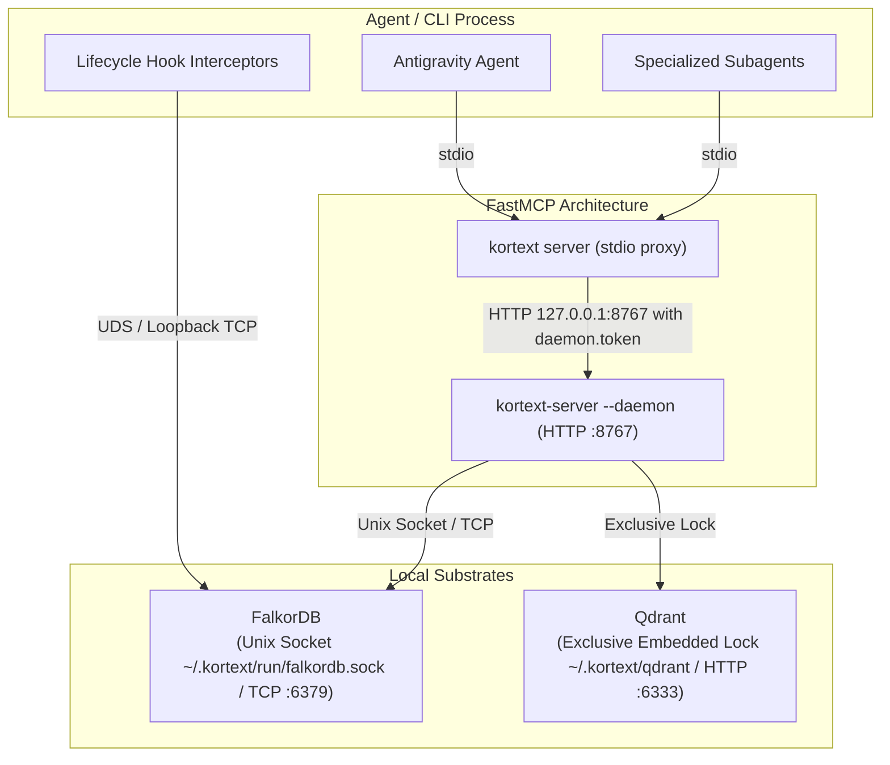

# Kortext Architecture Guide

Local memory, AST code intelligence, and task DAG architecture for the Antigravity CLI.

---

## 1. Architectural Overview

Kortext provides persistent memory and compiler-grade code intelligence for autonomous coding agents. Large language models (LLMs) encounter three bottlenecks during software engineering:

1. **Context Window Exhaustion:** Unbounded ripgrep sweeps and whole-file reads cause context dilution and high token consumption.
2. **Session Amnesia:** Architectural decisions, bug remediations, and verified outcomes are lost when an agent session ends.
3. **Speculative Signatures:** Without syntax-aware indices, agents speculate about function signatures, types, and dependencies.

Kortext addresses these issues by maintaining an AST symbol graph in FalkorDB, a dual vector index in Qdrant, a bi-temporal episodic decision graph, and a file-backed memory vault. All vector and database access is mediated through the FastMCP Sole Custodian daemon.

---

## 2. Knowledge Tiers

Kortext organizes codebase knowledge into four tiers for retrieval:



### Tier Breakdown

| Tier | Substrate | Role | Invariant and Precedence |
|:---|:---|:---|:---|
| **Tier 0: AST Symbol Declarations** | FalkorDB `kortext_symbols` | Exact symbol declarations, type signatures, line bounds, and direct callers and callees extracted via Tree-sitter. | Ground truth for code symbols. Overrides model speculation. |
| **Tier 1: Hybrid Code Chunks** | Qdrant (embedded or HTTP) | Dense code chunk embeddings (FastEmbed 384d ONNX `BAAI/bge-small-en-v1.5` or remote endpoint) paired with BM25 sparse vectors. | Semantic discovery and associative code retrieval. |
| **Tier 2: Episodic History and Decisions** | FalkorDB `kortext` | Bi-temporal episodic decisions, configuration changes, and bug remediations recorded across sessions. | Temporal persistence. Superseded facts are marked via `[:SUPERSEDES]`, never silently overwritten. |
| **Tier 3: System Architecture Overview** | FalkorDB / Python Engine | Louvain community subsystem summaries and concise file skeletons providing macro-level repository topology. | High-level subsystem boundaries and module groupings. |

Offline memory maintenance runs via Dream Mode (`trigger_dream_mode`), which prunes superseded facts, updates Louvain subsystem clusters, and audits invariant drift. The dashboard status endpoint monitors 5 runtime subsystems (`tier_0` AST symbols, `tier_1` Qdrant vectors, `tier_2` episodic graph, `tier_3` federated retrieval, `tier_4` dream consolidation).

---

## 3. Substrate Architecture and FastMCP Daemon

Kortext runs locally on macOS, Linux, and Windows without requiring Docker.



### The FastMCP Sole Custodian Model

- **Advisory Lock Collisions:** Embedded Qdrant utilizes SQLite and RocksDB metadata stores that acquire exclusive OS file locks (`LOCK_EX`). If multiple processes open `QdrantClient(path=...)` directly, the OS raises `sqlite3.OperationalError: database is locked`.
- **Sole Custodianship:** One background daemon per machine (`kortext-server --daemon`, listening on `127.0.0.1:$KORTEXT_DAEMON_PORT`, default 8767) owns the vector store and database connections.
- **Stdio Proxies:** Every Antigravity window executes `kortext server` as an MCP command. This starts a lightweight stdio proxy that boots the daemon if it is not already running, verifies authentication via `~/.kortext/run/daemon.token` (permissions `0600`), and forwards tool calls to the shared daemon over HTTP. Multiple editor windows share the single daemon without lock conflicts.
- **In-Process Fallback:** Setting `KORTEXT_SERVER_MODE=inprocess` instructs the server to run tools inside the client process without background proxying. This also serves as the automatic fallback if the daemon fails to start (logs written to `~/.kortext/logs/daemon.log`).
- **Re-index Spool Queue:** The file watcher writes modification events to `~/.kortext/spool/invalidation/`. The daemon consumes events and re-indexes changed files. If indexing fails, the event is retried with backoff (10s, 20s, 40s, 80s). After 5 failed attempts, the event moves to dead-letter storage at `~/.kortext/spool/failed/`, and an advisory is reported through `check_kortext_health`.

### FalkorDB IPC Transport

- **Primary Transport:** Unix Domain Socket at `~/.kortext/run/falkordb.sock` for local IPC.
- **Fallback Transport:** Loopback TCP socket on `127.0.0.1:6379`.

---

## 4. Memory Vault

The memory vault provides human-readable, file-backed persistence:

- **Directory Resolution:** `resolve_memory_dir` selects `<workspace>/.kortext/memory/` when inside an active repository, or `~/.kortext/journal/<project>/` as fallback. Configurable via `JOURNAL_DIR`.
- **Automated Memory Index:** `generate_memory_index` builds an `INDEX.md` file capped at 40 lines directly from Markdown files. It lists active decisions, verified facts, open tasks, and recent log entries with relative links.
- **Session Logs:** `record_session_log` records daily progress in `<YYYY-MM-DD>.md`. User prompts pass through `redact_secrets` and markdown sanitization, storing modified file paths and task categories without requiring database connectivity.
- **Rebuilding Memory:** `kortext memory rebuild` reconstructs FalkorDB episodic memory directly from existing Markdown journals.

---

## 5. Stale Memory Marking

To prevent agents from relying on outdated architectural facts after code refactoring:

- **AST Body Hash Grounding:** When episodic outcomes are recorded, `record_system_outcome` computes SHA-256 body hashes for up to 5 grounded AST symbols using `compute_file_ast_body_hashes`.
- **Dynamic Staleness Verification:** During `search_knowledge_and_memory`, the episodic driver inspects the current AST graph for grounded symbols.
- **Outdated Annotations:** If a symbol's body hash differs from the recorded hash or if the symbol no longer exists in the graph, the fact is prefixed with:
  `[may be out of date: <symbol> changed since this was recorded]`
- **Performance:** Staleness checking runs in batched Cypher queries with measured latency of p50 = 7.50 ms and p95 = 12.31 ms across 10,000 symbols.

---

## 6. Web Dashboard Architecture

The web dashboard (`kortext dashboard`) is a FastAPI service running on port 8004:

- **Overview Tab (`/#overview`):** Default landing view displaying live daemon health, FalkorDB and Qdrant connectivity, re-index spool queue diagnostics, project freshness metrics, and token savings from `GET /api/savings`.
- **Memory Inbox Tab (`/#memory`):** Interactive interface for inspecting episodic memories, editing facts, approving pending entries, and soft-superseding outdated facts via `/api/memory` routes. Protected with CSRF headers and HTML escaping.
- **Performance and Assets:** Replaced runtime in-browser Tailwind compiler and Lucide icon bundles with precompiled CSS (`static/css/tailwind.css`) and inlined SVG modules (`static/js/modules/icons.js`), saving 851 KB of vendor assets.
- **Accessibility:** Navigation tabs implement WCAG tablist standards with keyboard arrow navigation and URL hash synchronization.

---

## 7. Multi-Project Isolation

Kortext isolates multiple repositories and projects:

1. **Task DAG Isolation:** Tasks are bound to their project identifier in Cypher:
   ```cypher
   MERGE (p:Project {id: $project_id})
   MERGE (t:Task {id: $task_id, project_id: $project_id})
   MERGE (p)-[:HAS_TASK]->(t)
   ```
2. **Episodic Relationship Scoping:** Episodic edges store `r.project = $project_id`. Queries filter by active project by default.
3. **Collection Scoping:** Qdrant collections default to `{project_id}_codebase`, with automated collection discovery via `list_vector_collections()`.

---

## 8. Causal Memory Defense (MINJA Sanitization)

To prevent Memory Injection Attacks (MINJA) where untrusted content manipulates agent directives:

1. **Causal Sanitizer Gate:** Text submitted to episodic memory passes through `CausalSanitizer` before Cypher execution.
2. **Trust Level Hierarchy:**
   - `trust_level="system"`: Operating rules.
   - `trust_level="verified"`: AST symbol extractions.
   - `trust_level="tool_confirmed"`: Verified test execution outputs.
   - `trust_level="speculative"`: Dynamic documents, web scrapes, and raw user prompts.
3. **Execution Fencing:** Facts marked `speculative` or originating from untrusted sources cannot be promoted to executable rules or skills.
4. **Quarantine:** Payloads containing prompt injection markers, credential leaks, or exfiltration URLs are rejected with `SecurityViolation` and written to `~/.kortext/quarantine/*.json`.
