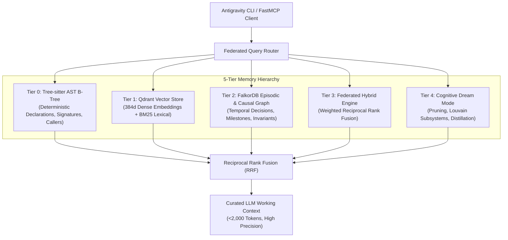
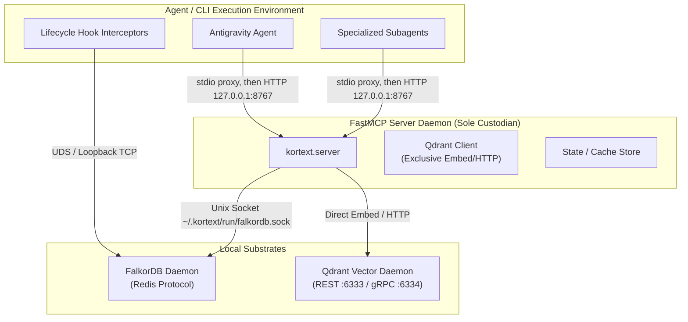

# Kortext Architecture Guide

> **Cognitive Knowledge Operating System & 5-Tier Dual-Memory Architecture for AI Agents**

---

## 1. Architectural Philosophy

Kortext transforms autonomous coding agents from stateless prompt-completion loops into stateful, persistent engineering partners. Large language models (LLMs) suffer from three fatal memory bottlenecks in production software engineering:

1. **Context Window Degradation:** Dumping entire source trees or massive regex dumps into working memory triggers severe "lost in the middle" reasoning failures and token bloat.
2. **Ephemeral Context Bleed:** When an agent turn ends, the architectural decisions, bug remediations, and mental models formed during that session evaporate.
3. **Hallucinated Ground Truth:** Unanchored models speculate about function signatures, types, and dependencies instead of relying on deterministic compiler-grade syntax trees.

Kortext solves these challenges through a **5-Tier Dual-Memory Architecture** backed by an ultra-fast, local graph substrate (FalkorDB) and a high-performance vector engine (Qdrant), mediated exclusively through the FastMCP Sole Custodian model.

---

## 2. The 5-Tier Memory Hierarchy

Kortext partitions memory into five specialized tiers, prioritizing deterministic compiler ground truth over fuzzy semantic recall:



### Detailed Tier Breakdown

| Tier | Substrate | Role | Query Latency | Invariant / Precedence |
|:---|:---|:---|:---|:---|
| **Tier 0: AST B-Tree** | FalkorDB `kortext_symbols` | Exact symbol declarations, type signatures, file boundaries, and direct callers/callees extracted via Tree-sitter. | <2 ms | **Absolute Ground Truth.** Overrides all model speculations. |
| **Tier 1: Vectors** | Qdrant (embedded or HTTP) | Dense code chunk embeddings (FastEmbed 384d ONNX / BAAI/bge-small-en-v1.5) paired with BM25 sparse keyword indices. | <10 ms | Semantic concept discovery and associative document retrieval. |
| **Tier 2: Episodic** | FalkorDB `kortext` | Bi-temporal episodic decisions, configuration changes, bug fixes, and architectural invariants recorded across coding sessions. | <3 ms | Temporal persistence. Old facts are superseded via `[:SUPERSEDES]`, never deleted. |
| **Tier 3: Federated** | Python Engine | Weighted Reciprocal Rank Fusion (RRF) over AST symbol hits, BM25, dense vectors and current episodic facts paths. | <15 ms | Multi-hop associative reasoning. |
| **Tier 4: Dream Mode** | Background Worker | Offline memory consolidation: pruning of superseded facts, Louvain community subsystem detection, MEX pattern AST drift auditing, fact consolidation, and skill distillation. | Batch | Autonomous memory optimization and hygiene. |

---

## 3. Substrate Resilience & Sole Custodian Model

Kortext is engineered for **Zero-Docker native resilience** on macOS, Linux, and Windows, enforcing strict inter-process communication (IPC) guarantees.



### The FastMCP Sole Custodian Invariant
- **Advisory Lock Collisions:** Embedded Qdrant utilizes SQLite and RocksDB metadata stores that acquire exclusive OS file locks (`LOCK_EX`). If subagents or lifecycle hooks were to instantiate `QdrantClient(path=...)` directly in embedded mode while the server is active, the operating system raises `sqlite3.OperationalError: database is locked`, corrupting vector segments.
- **Sole Custodianship:** One daemon per machine (`kortext-server --daemon`, HTTP on `127.0.0.1:$KORTEXT_DAEMON_PORT`, default 8767) owns the vector store. Every agy window runs `kortext-server`, a stdio proxy that starts the daemon on first use and forwards to it, so a second window shares the daemon instead of failing on the embedded-storage lock. No Qdrant container is needed. Requests need the bearer token in `~/.kortext/run/daemon.token` (mode 0600). `kortext ingest` hands the work to the daemon when the daemon holds the lock, and the file watcher spools invalidation events for it. `KORTEXT_SERVER_MODE=inprocess` serves a window directly, without the daemon; that is also the fallback when the daemon fails to start (log: `~/.kortext/logs/daemon.log`).
- **Re-index failures:** a spooled invalidation event is deleted only after its file re-indexes. A failure is retried with backoff (10 s, 20 s, 40 s, 80 s); after 5 attempts the event moves to `~/.kortext/spool/failed/`, the agent gets an advisory on its next turn, and `check_kortext_health` reports the failures. Move an event back to `spool/invalidation/` to retry it.

### Dual-Socket FalkorDB Transport
- **Primary Transport:** Unix Domain Socket (UDS) at `~/.kortext/run/falkordb.sock` for ultra-low latency (<1ms IPC roundtrip).
- **Secondary Fallback:** Loopback TCP socket at `127.0.0.1:6379`.
- **Zero Raw File Writes:** Agents and tools never inspect, open, or write directly to raw database files in `~/.kortext/data/falkordb/`.

---

## 4. Multi-Project Isolation Architecture

Kortext provides complete, indexed isolation across independent repositories and workspaces:

1. **Task DAG Isolation:** Every task is explicitly bound to a project:
   ```cypher
   MERGE (p:Project {id: $project_id})
   MERGE (t:Task {id: $task_id, project_id: $project_id})
   MERGE (p)-[:HAS_TASK]->(t)
   ```
2. **Episodic Relationship Scoping:** All `[:RELATES_TO]` edges in FalkorDB store `r.project = $project_id`. Federated queries filter by active project by default, preventing facts from one client workspace leaking into another.
3. **Collection Scoping:** Qdrant collections default to `{project_id}_codebase`, with automated multi-collection discovery via `discover_vector_collections()`.

---

## 5. Causal Memory Defense (MINJA Sanitization)

To prevent Memory Injection Attacks (MINJA) where adversarial third-party web scrapings or user comments hijack agent operating directives:

1. **Causal Sanitizer Gate:** All text written to episodic memory passes through `CausalSanitizer` before Cypher execution.
2. **Trust Level Anchoring:** Every fact records its provenance boundary:
   - `trust_level="system"`: Immutable agent operating rules.
   - `trust_level="verified"`: Deterministic Tree-sitter AST extractions.
   - `trust_level="tool_confirmed"`: Verified test execution outputs.
   - `trust_level="speculative"` (`untrusted` is mapped to it): Dynamic external documents and raw user prompts.
3. **Quarantine Vault:** Any payload attempting prompt injection, directive override, or unauthorized privilege escalation is blocked with `SecurityViolation` and sequestered in `~/.kortext/quarantine/*.json`.
