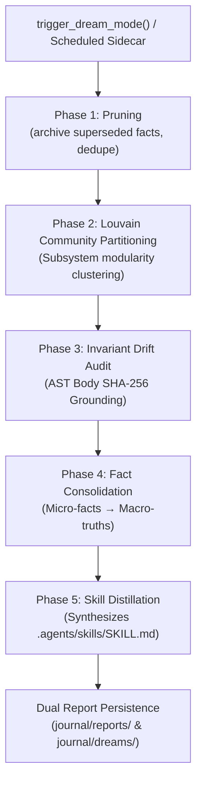

# Kortext Hybrid Dream Mode Guide

> **Fact pruning, Louvain community partitioning, invariant drift audit and skill distillation**

---

## 1. What is Cognitive Dream Mode?

In human cognition, sleep serves two essential memory functions:
1. **Synaptic Homeostasis:** Low-relevance memories and noise are pruned to prevent synaptic overload.
2. **Memory Consolidation:** Specific episodic memories are integrated into high-level macro-concepts and generalized skills.

Kortext implements a **Hybrid Dream Mode** that bridges fast substrate graph algorithms with high-level LLM reflection across **6 sequential phases** (1 to 6):



---

## 2. Phase 1: Pruning

Facts are never decayed by age. A fact leaves search results only when it is superseded (by `supersedes`, by `consolidate_facts`, or by `delete_fact`) or its `valid_to` has passed. Phase 1 archives superseded facts of the dreaming project to `journal/archive/` before it deletes them, deduplicates near-identical facts, and merges near-duplicate entity names.

---

## 3. Phase 2: Louvain Community Subsystem Partitioning

Over time, large codebases develop invisible modular clusters. In Phase 2, Kortext runs the **Louvain modularity optimization algorithm** over the `[:CALLS]`, `[:IMPORTS]`, and `[:REFERENCES]` graph in `kortext_symbols`:

1. It maximizes network modularity $Q$ by grouping tightly coupled files and symbols into cohesive communities.
2. It generates `(:Subsystem)` nodes in FalkorDB (e.g., `Retrieval Subsystem`, `Task Engine`, `Hooks Pipeline`).
3. It links each source file to its detected community via `[:BELONGS_TO]`.
4. These subsystems provide the foundation for the **Anti-Hairball Subsystems Architecture View** in the Kortext Dashboard!

---

## 4. Phase 3: Invariant Drift Audit (The MEX Pattern)

To ensure that architectural rules don't become stale documentation, Kortext implements the **MEX Grounding Pattern**:
- Every architectural rule $R$ in `journal/invariants.md` is grounded to a concrete AST symbol and its normalized body hash:
  $$\text{Invariant}(R) \xrightarrow{\text{grounds to}} \left(\text{symbol\_name}, \text{SHA256}(\text{AST\_body})\right)$$

During Phase 3:
1. Kortext re-computes the Tree-sitter AST body hash for each grounded symbol.
2. If the live hash diverges from the recorded hash, the invariant is flagged as **`DRIFTED`**.
3. If the symbol was deleted or renamed, the invariant is flagged as **`ORPHANED`**.
4. The agent is notified with an advisory recommending review or re-grounding.

---

## 5. Phase 4: Granular Fact Consolidation

Coding sessions frequently record dozens of micro-facts:
- *"Switched FalkorDB port to 6379"*
- *"Added UDS fallback to port 6379"*
- *"Set FALKORDB_PORT=6379 in .env"*

In Phase 4, the agent or dream engine merges these micro-facts into a single **Macro-Truth**:
- **Macro-Truth:** *"FalkorDB operates on UDS socket ~/.kortext/run/falkordb.sock with loopback TCP 6379 fallback."*
- **Supersession:** Granular micro-facts are updated in FalkorDB with `SET r.superseded = true, r.dormant = true, r.superseded_by = $macro_fact_id`. When the superseded facts span more than one (subject, object) pair, the item must name `subject` and `object`; otherwise it is skipped.
- Granular facts remain in historical audit logs without cluttering daily retrieval.

---

## 6. Phase 5: Autonomous Skill Distillation

When the agent observes recurring implementation patterns or solves complex tooling setups, Phase 5 synthesizes the solution into a permanent, reusable skill:
1. Generates `SKILL.md` with valid YAML frontmatter (`name`, `description`).
2. Persists the skill to `.agents/skills/<name>/SKILL.md` (project scope) or `~/.gemini/config/plugins/kortext/skills/` (global scope).
3. The distilled skill becomes immediately available to all future agent sessions via the Antigravity skill discovery system!

---

## 7. Invocation & Scheduling

### Via FastMCP Tool
```python
await trigger_dream_mode(
    project="kortext",
    purge_stale=True,
    consolidations=[
        {
            "macro_fact": "Unified FalkorDB IPC protocol across UDS and TCP",
            "superseded_fact_ids": ["fact_102", "fact_103"]
        }
    ]
)
```

### Via CLI & Scheduled Sidecar
- Run manually: `kortext dream`
- Run automatically in background: Configure the native Antigravity sidecar `integrations/antigravity/sidecars/kortext-dream/sidecar.json`.
