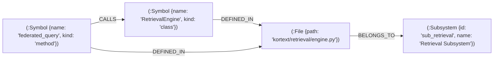
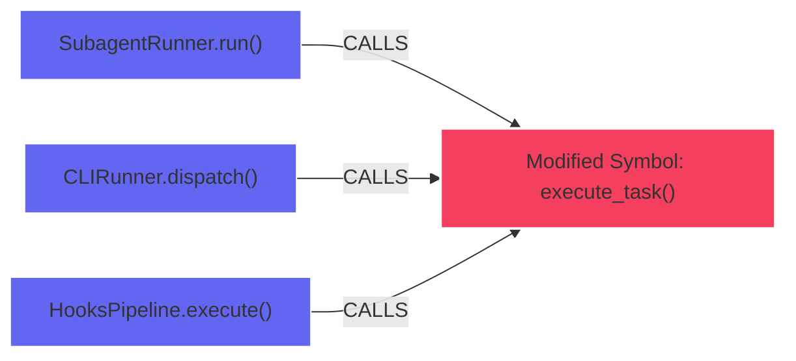

# Kortext AST Code Intelligence & Symbol Seeking Guide

> **Deterministic Tree-sitter Syntax Analysis, AST B-Tree Indexing, and the Anti-Ripgrep Mandate**

---

## 1. The Anti-Ripgrep Mandate

Traditional AI coding assistants rely heavily on `ripgrep` (`rg`), `grep_search`, or raw regex scans across codebases to locate functions and classes. In medium-to-large codebases, this pattern introduces severe failure modes:

1. **Context Window Token Bloat:** A single broad ripgrep scan returns 5,000 to 15,000 tokens of noisy output containing partial substring matches, commented-out code, and mock variables.
2. **Context Fragmentation & Lost-in-the-Middle:** Polluting the LLM working memory with raw grep dumps triggers reasoning degradation and hallucination in subsequent agent turns.
3. **Zero Semantic Precision:** Regex cannot differentiate between a function declaration, a caller invocation, an imported name, or a variable name collision.

### The Kortext Solution
Instead of brute-force text scans, Kortext provides **compiler-grade AST B-Tree symbol lookups** via Tree-sitter and FalkorDB:
- **`seek_symbol(symbol_name="<symbol>")`:** Direct point lookup returning the exact file path, start/end lines, full type signature, docstring, and callers in **<2ms** and **~120 tokens** (>95% token savings).
- **`trace_symbol_impact(symbol="<symbol>", direction="upstream"|"downstream")`:** Multi-hop graph traversal over the `kortext_symbols` graph assessing refactoring blast radius (p50 under 10 ms in `tests/test_empirical_benchmarks.py`).

---

## 2. Supported Languages & Multi-Language Tree-sitter Support

Kortext supports 10+ major programming languages out of the box using official Tree-sitter grammars:

| Language | Extensions | Grammar Package | Extracted Constructs |
|:---|:---|:---|:---|
| **Python** | `.py`, `.pyi` | `tree-sitter-python` | Functions, Async Functions, Classes, Methods, Type Aliases, Decorators |
| **TypeScript** | `.ts`, `.tsx` | `tree-sitter-typescript` | Interfaces, Classes, Type Aliases, Functions, Methods, Enums |
| **JavaScript** | `.js`, `.jsx`, `.mjs` | `tree-sitter-javascript` | Functions, Classes, Arrow Functions, Prototypes |
| **Rust** | `.rs` | `tree-sitter-rust` | Functions, Structs, Enums, Traits, Impl Blocks, Type Aliases |
| **Go** | `.go` | `tree-sitter-go` | Functions, Methods, Structs, Interfaces, Types |
| **C / C++** | `.c`, `.cpp`, `.h`, `.hpp` | `tree-sitter-c`, `tree-sitter-cpp` | Functions, Classes, Structs, Enums, Typedefs |
| **Java** | `.java` | `tree-sitter-java` | Classes, Interfaces, Records, Methods, Enums |
| **Kotlin** | `.kt` | `tree-sitter-kotlin` | Functions, Classes, Interfaces, Data Classes |
| **Swift** | `.swift` | `tree-sitter-swift` | Functions, Structs, Classes, Protocols, Extensions |

---

## 3. The `kortext_symbols` Graph Schema

Symbol intelligence is stored in an isolated, dedicated FalkorDB graph (`kortext_symbols`) to prevent syntax noise from polluting temporal episodic decision history.



### Node & Relationship Definitions

- **`(:Symbol)`**: Holds `name`, `kind` (`function`, `class`, `method`, `interface`), `file_path`, `line_start`, `line_end`, and `signature`.
- **`(:File)`**: Holds `path` and modification timestamp.
- **`(:Subsystem)`**: Represents a Louvain modularity community cluster computed during offline Dream cycles.
- **`[:DEFINED_IN]`**: Links a symbol to its containing source file.
- **`[:CALLS]`**: Directed execution edge from caller to callee.
- **`[:IMPORTS]`**: Directed dependency edge between source files.
- **`[:BELONGS_TO]`**: Maps files to high-level architectural Louvain subsystems.

---

## 4. `seek_symbol` API & Usage

### FastMCP Tool Invocations

```python
# Direct symbol seek
result = await seek_symbol(symbol_name="RetrievalEngine")
```

### JSON Response Schema
```json
{
  "symbol": "RetrievalEngine",
  "kind": "class",
  "file_path": "/path/to/project/kortext/retrieval/engine.py",
  "start_line": 42,
  "end_line": 218,
  "signature": "class RetrievalEngine(DenseEmbedderProtocol)",
  "docstring": "Federated multi-tier retrieval orchestrator supporting RRF.",
  "immediate_callers": ["federated_query", "search_knowledge_and_memory"],
  "immediate_callees": ["_fetch_tier0", "_fetch_tier1", "_fetch_tier2"]
}
```

---

## 5. `trace_symbol_impact` (Blast Radius Analysis)

When refactoring, modifying signatures, or deleting methods, agents must assess the blast radius of their changes before editing code.

### Blast Radius Directions
- **`direction="upstream"` (The Caller Blast Radius):** Traverses incoming `[:CALLS]` and `[:REFERENCES]` edges up to $N$ hops to identify all downstream components that depend on this symbol.
- **`direction="downstream"` (The Dependency Graph):** Traverses outgoing edges to determine what libraries, utilities, and helper functions this symbol relies on.



### Token-Bounded Progressive Degradation
To prevent deep call graphs from overflowing context, `trace_symbol_impact` applies **progressive degradation**:
1. Depth 1 callers receive full file paths, line numbers, and signatures.
2. Depth 2+ callers receive compact identifier paths (`module.function`).
3. Total response size is capped at 1,500 tokens by default (`token_budget`).

---

## 6. Incremental AST Sync & Orphan Pruning

When files are modified by tools (`replace_file_content`, `write_to_file`):
1. **`IncrementalASTSync` Hook:** Intercepts the post-tool event and parses only the modified file using Tree-sitter.
2. **Orphan Pruning Sweep:**
   Before updating definitions, Kortext queries pre-existing symbols defined in the file. Any symbol deleted from the source file is automatically purged from FalkorDB via an immediate orphan sweep:
   ```cypher
   UNWIND $candidate_names AS name
   MATCH (s:Symbol {name: name})
   WHERE NOT (s)-[:DEFINED_IN]->(:File)
   DETACH DELETE s
   ```
   Symbols shared across multiple files or re-declared are safely preserved.
